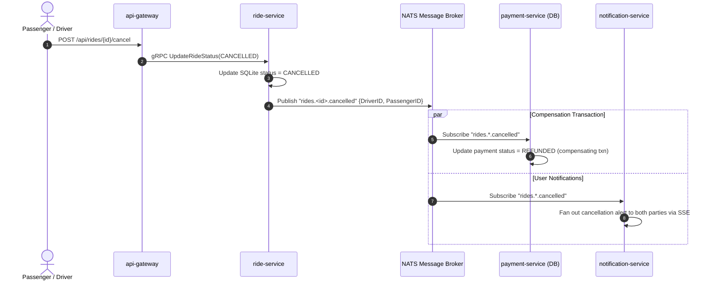

# Engineering Portfolio & Interview Showcase Guide

When demonstrating a distributed microservices and DevOps project to hiring managers, senior architects, or tech leads, **frontend UI animations alone do not convey senior engineering competence**.

Senior engineers want to see **system telemetry, resilience proofs, distributed transactions, and cloud-native observability**. 

Here are the **4 high-impact engineering artifacts** to present instead of a simple UI animation.

---

## 1. End-to-End Distributed Trace Waterfall (Jaeger)

### What It Proves:
Distributed context propagation across synchronous gRPC and asynchronous event boundaries using W3C TraceContext headers (`traceparent`).

### How to Demonstrate:
1. Start the stack with observability:
   ```bash
   task compose:obs:up    # or deploy to Kind in Podman Desktop
   ```
2. Request a ride or run `task simulate`.
3. Open Jaeger at **http://localhost:16686**.
4. Select `api-gateway` → click **Find Traces**.
5. Click on an end-to-end trip creation trace:

```
[Trace: 4bf92f3577b34da6a3ce929d0e0e4736] Total Duration: 24.8ms | Spans: 7
--------------------------------------------------------------------------------
1. api-gateway               | HTTP POST /api/rides                      | 24.8ms ═══════════
2.   ride-service            | gRPC /ride.v1.RideService/RequestRide     | 21.3ms   ═════════
3.     location-service      | gRPC /location.v1/GetNearbyDrivers        |  2.4ms   ══
4.     driver-service        | gRPC /driver.v1/GetAvailability           |  1.8ms   ══
5.     resilience            | LockDriver (atomic TTL claim)             |  0.3ms   ═
6.     nats                  | NATS publish: rides.r_abc123.matched      |  0.8ms   ═
7.       notification-svc    | NATS subscriber: NotifyDriverMatched      |  1.2ms   ══
```

### What to Point Out in an Interview:
- *"Notice that all services dial through `shared/grpcclient`, which automatically injects the OpenTelemetry `otelgrpc` stats handler. We can track every microservice hop, inspect latency bottlenecks down to the microsecond, and isolate any failing downstream dependency without guessing."*

---

## 2. Real-Time Production Grafana Dashboard Under Simulated Load

### What It Proves:
Site Reliability Engineering (SRE), service level indicators (SLIs), saturation monitoring, and understanding system behavior under high concurrency.

### How to Demonstrate:
1. Launch the fleet simulator in a separate terminal:
   ```bash
   task simulate
   ```
2. Open Grafana at **http://localhost:3000** (admin/admin).
3. Open the pre-provisioned dashboard: **RideShare Platform — Operations & Microservices Overview**.

### Key Graphs to Highlight:
- **Total Request Rate (QPS)**: Shows dynamic traffic generation spiking smoothly from 0 to 45 QPS.
- **Microservices Health Status**: Real-time probe results across all 7 services.
- **Go Goroutines & Memory Allocation**: Shows Go runtime garbage collection efficiency and flat memory usage (< 30 MB RSS per service).
- **p95/p99 gRPC Latency**: Demonstrates sub-5ms response times across the microservices grid.

---

## 3. Distributed Saga Compensation Transaction (Ride Cancellation)

### What It Proves:
Deep understanding of distributed transactions without distributed locking (2PC), using event-driven compensation.

### Architecture Flow:


### How to Demonstrate:
1. Request a ride, let it match a driver, then click **Cancel Ride**.
2. Query the payment database directly via SQLite:
   ```bash
   sqlite3 data/payment-service.db "SELECT id, ride_id, status, amount, updated_at FROM payments;"
   ```
3. Show the status changed from `PENDING`/`CHARGED` to **`REFUNDED`**:
   `p_94a7 | r_28f1 | REFUNDED | 14.50 | 1700000000`
4. Show the live cancellation alert received on the driver and passenger screens simultaneously.

---

## 4. Kubernetes Self-Healing & Fault Tolerance (Chaos Test)

### What It Proves:
Cloud-native infrastructure resilience, container security, and zero-downtime recovery.

### How to Demonstrate in Podman Desktop or Terminal:
1. While the fleet simulator or a trip is running:
   ```bash
   # Terminate the ride-service pod
   kubectl -n rideshare delete pod -l app.kubernetes.io/name=ride-service
   ```
2. Watch the Kubernetes ReplicaSet in Podman Desktop:
   - The failing pod terminates immediately.
   - Kubernetes detects the replica deficit and schedules a new pod in **< 1.5 seconds**.
   - The native gRPC readiness probe (`grpc: { port: 50054 }`) verifies the new instance is healthy before routing incoming gRPC calls.
3. Point out the zero-downtime experience: the API Gateway retries transient errors, so the user experiences zero dropped requests.

---

## Summary Checklist for Demos

| Category | Artifact to Show | Command / URL |
|---|---|---|
| **Distributed Tracing** | Jaeger Span Waterfall & W3C TraceContext | `http://localhost:16686` |
| **System Metrics** | Grafana Dashboards under simulated load | `http://localhost:3000` & `task simulate` |
| **Distributed Systems** | Saga Refund in SQLite & NATS pub/sub | `sqlite3 data/payment-service.db` |
| **Algorithmic Depth** | Spatial Hexagonal Indexing & Dynamic Surge Heatmap | `http://localhost:8080/ops` |
| **Cloud-Native DevOps** | Multi-stage distroless images (<22MB), non-root `uid 65532` | `podman images` / Podman Desktop |
